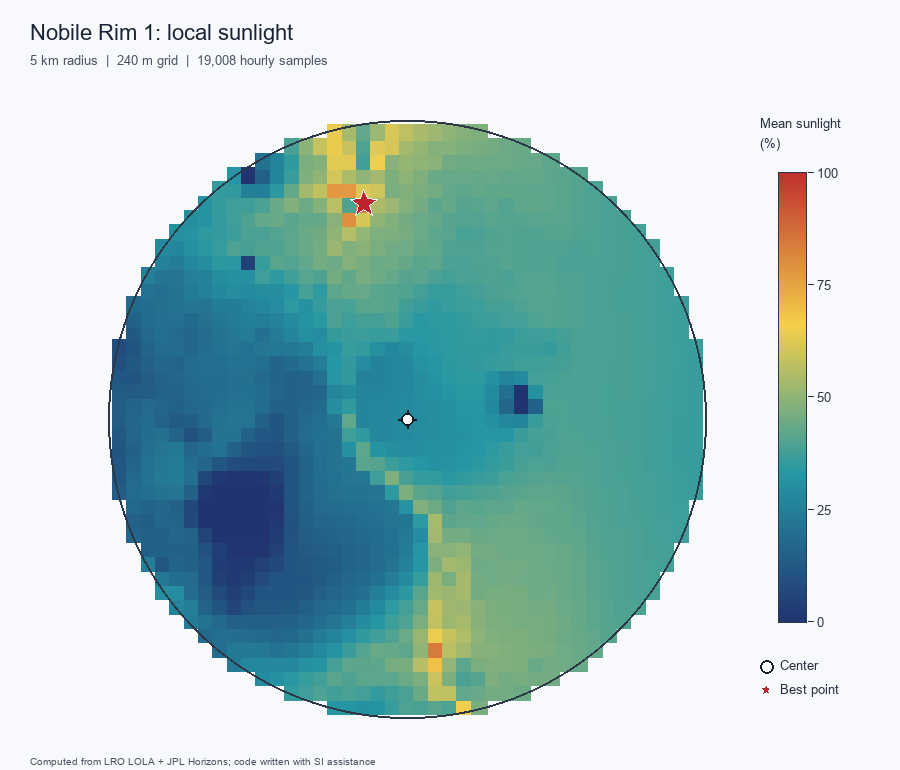

# Lunar Landing Site Navigator

**NASA Space Apps Challenge 2026 · Challenge: Lunar Landing Site Navigator**

Launch slipped? Pick the new landing date and see which lunar landing sites still work, and why.

- **Live app:** https://lunar-landing-site-navigator-sigma.vercel.app
- **Demo scenario** (a two-week slip at Mons Mouton):
  https://lunar-landing-site-navigator-sigma.vercel.app/?region=south-pole&date=2027-11-27T12:00&orig=2027-11-13T12:00&site=viper_mons_mouton_target
- **A few kilometres change everything** (Nobile Rim 1):
  https://lunar-landing-site-navigator-sigma.vercel.app/?region=south-pole&date=2027-11-27T12:00&site=artemis_nobile_rim_1&sel=artemis_nobile_rim_1



At the Nobile Rim 1 reference point (on a 13° slope) the Sun is up 29% of the time and Earth never
rises above the terrain. A ridge 3.7 km away gets 85% sunlight and sees Earth 62% of the time.

## What it does

- **Ranks sites like players.** Each site gets a card with sunlight, Earth link, night survival,
  time to sunset and Earthset, and Sun height, plus a GO / RISKY / NO-GO verdict against thresholds you set.
- **Shows why.** A 360° horizon panorama with the Sun and Earth paths over the mission, a day-by-day
  light and link timeline, and plain-language reasons.
- **Suggests tactics.** The best alternative site for the new date, the nearest date shift that makes
  your planned site GO, and a "match preview" of its strengths and weaknesses.
- **Compares before and after.** Enter the original date to see what the slip changed.
- **Launch window calendar.** Verdicts for every site from 14 days before to 45 days after the chosen
  date; click a day to adopt it.
- **Better spot nearby** (polar sites). A 240 m map of two-year sunlight, Earth visibility and ground
  slope within 5 km, with the best spot named and checked against your own dates.
- **Any coordinates.** Add a custom point; its Sun and Earth positions come live from JPL Horizons.
  South of 83.5°S a server function also computes its LOLA terrain horizon and slope; elsewhere the
  horizon is flat (flagged in the app).
- **Explain the math.** Coach notes put each site's numbers into the formulas, and an interactive
  latitude lab shows why the polar Sun stays low.
- **Share.** The URL always mirrors the scenario.

## How it works

1. **Sun and Earth:** JPL Horizons, apparent airless azimuth and elevation, hourly from 1 Nov 2026 to
   31 Dec 2028, for 12 sites ([`pipeline/fetch_horizons.mjs`](pipeline/fetch_horizons.mjs)). Custom
   points use the same query through a server function ([`web/api/horizons.ts`](web/api/horizons.ts)).
2. **Terrain:** LRO LOLA `LDEM_75S_120M` (120 m). For each polar site, the highest terrain angle in
   each of 360 directions out to 150 km, including lunar curvature, seen from 2 m above the ground
   ([`pipeline/horizon_mask.py`](pipeline/horizon_mask.py)); the same for 1,361 points within 5 km
   ([`pipeline/neighborhood.py`](pipeline/neighborhood.py)). Custom points south of 83.5°S get the same
   horizon on demand from a packed copy of the DEM ([`web/api/terrain.ts`](web/api/terrain.ts),
   built by [`pipeline/terrain_grid.py`](pipeline/terrain_grid.py)); it reproduces the precomputed site
   horizons within 0.04°.
3. **Every hour:** the visible fraction of the solar disk above the terrain, and whether any part of
   Earth clears it. Mission averages give the verdict; the same evaluation drives the ranking, the date
   shift and the calendar. Formats and formulas: [`docs/data-format.md`](docs/data-format.md).

## Validation

- At the six polar site reference points, our two-year sunlight averages differ from NASA's long-term
  LOLA average-illumination map (PGDA product 69, Mazarico et al. 2011) by −1.0 to +2.5 percentage points
  ([`docs/validation.md`](docs/validation.md)). Periods and model settings differ, and the map squares
  and individual mission windows are not separately validated.
- Horizon masks re-derived with independent code from NASA Moon Trek's LOLA service agree within about
  0.2° (both use LOLA, so this checks consistency, not absolute accuracy).
- For the nearby-spot grids, Sun and Earth directions are rotated into each point's local frame; at a
  Haworth candidate 3.9 km away they match JPL Horizons queried directly there within 0.005°.
- Sun positions checked against the Apollo 11 landing (Sun about 10.7° high in the east at 20:17 UT)
  and against the 90° − |latitude| + 1.54° limit at every site.
- The on-demand terrain horizon reproduces the five catalog horizons inside its zone within 0.04°, and
  the date-specific check of each best spot reproduces the pipeline's two-year averages within 0.5
  percentage points (tested in `web/src/lib/terrain.test.ts`).
- 136 automated tests (`npm test`).

## Limitations

- GO means the mission-average thresholds are met. It is not a promise of continuous sunlight, a radio
  link budget, or a safe landing.
- Terrain is modeled for the six polar catalog sites and for custom points south of 83.5°S. Other custom
  points and the lower-latitude sites use a flat horizon, which is optimistic near the pole; the app
  flags flat-horizon polar points and never offers one as the best pick.
- The nearby-spot map shows two-year averages. Only the named best spot also gets a verdict for your
  dates; the map does not search for the best spot on those dates.
- Slope comes from the 120 m DEM, so boulders and small craters are not resolved. The 8° limit is this
  tool's screening value, not a lander requirement.
- Candidate-region reference points from the literature are not approved landing sites.

## Data sources

NASA JPL Horizons, LRO LOLA (PDS Geosciences), NASA GSFC PGDA, NASA Moon Trek, LROC, NASA NSSDC,
NASA mission pages, ISRO and JAXA. Site coordinates and their provenance:
[`docs/sites-sources.md`](docs/sites-sources.md). Full references and credits:
[`docs/submission.md`](docs/submission.md).

## Run locally

```bash
cd web
npm install
npm run dev      # http://localhost:5173
npm test         # 120 logic tests
```

Data pipeline (from the repository root): `node pipeline/fetch_horizons.mjs` for ephemerides;
`python pipeline/horizon_mask.py` and `python pipeline/neighborhood.py` for terrain
(see [`pipeline/README.md`](pipeline/README.md)).

## Repository

| Path | Contents |
|---|---|
| `web/` | React + TypeScript + Vite app, and the Horizons server function for custom points |
| `web/public/data/` | Site catalog, ephemerides, horizon masks, neighborhood grids |
| `pipeline/` | Data pipeline: JPL Horizons (Node.js), LOLA terrain (Python) |
| `docs/` | Data format, sources, validation, submission texts, demo script, SI usage log |

## Use of Super Intelligence (SI)

The team chose the idea, the target users, the features and the thresholds, and reviewed every result.
SI tools helped build it: Claude Code (Anthropic) with the web app, the Horizons script and reviews;
ChatGPT and Codex (OpenAI) with source research, the LOLA terrain pipeline, two app features and the
submission texts. Every contribution is logged in [`docs/SI_USAGE.md`](docs/SI_USAGE.md).
